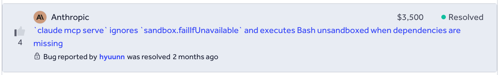
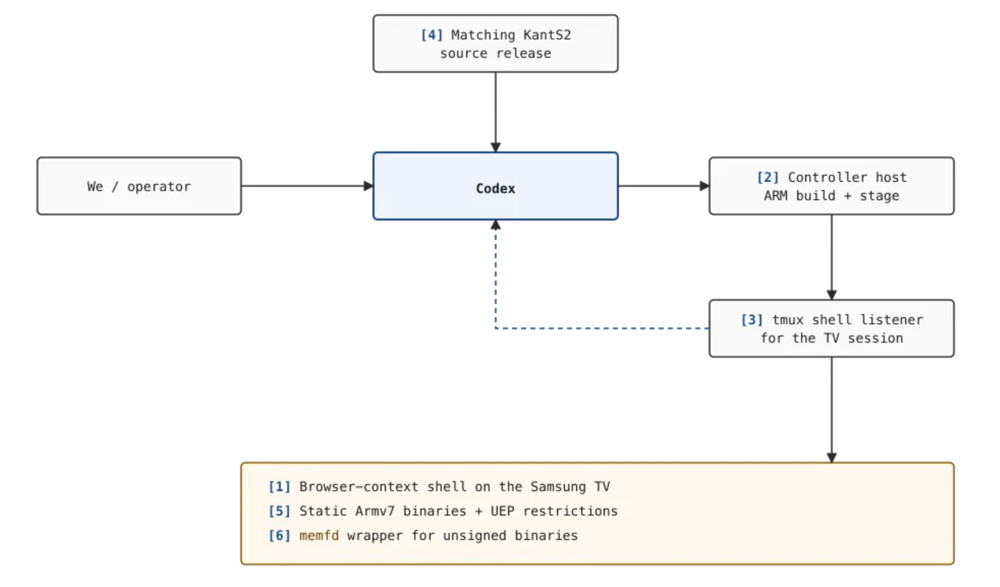
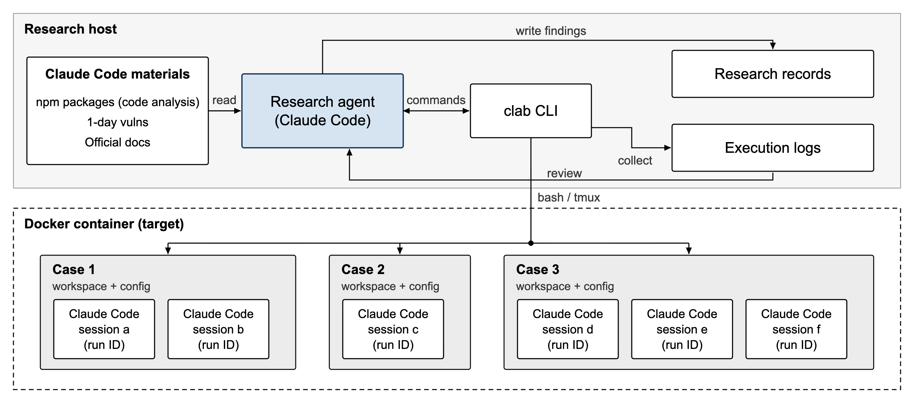
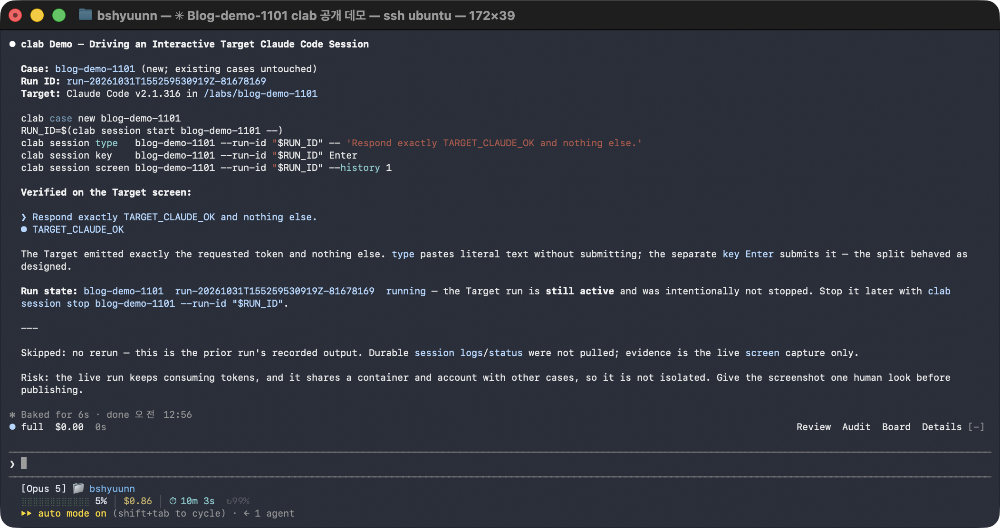
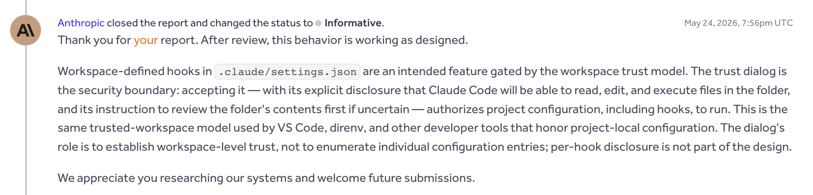
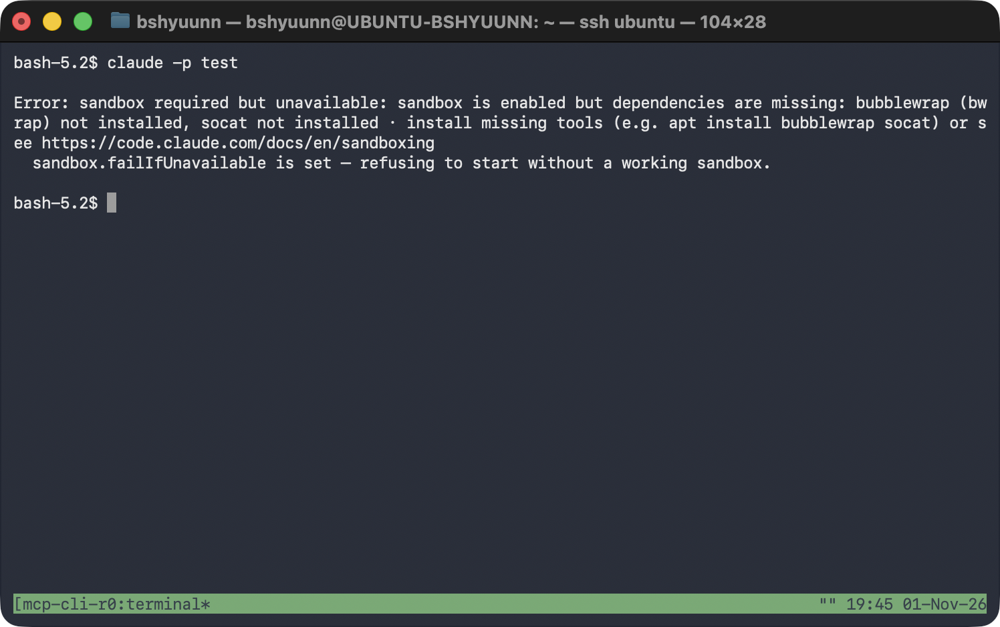
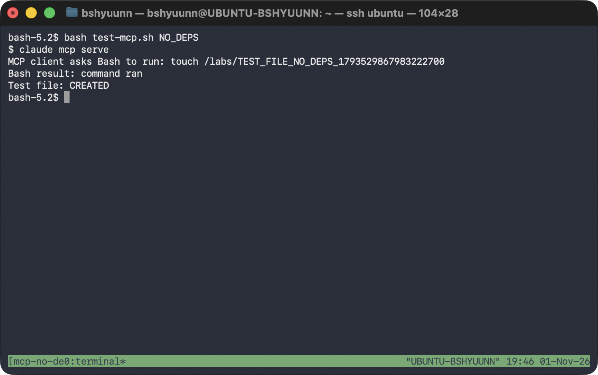
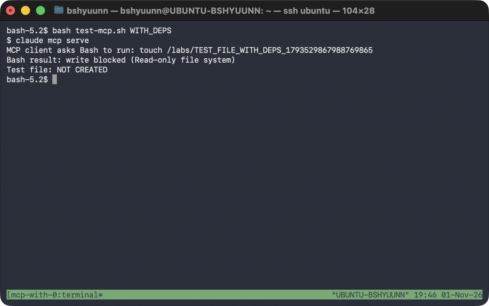
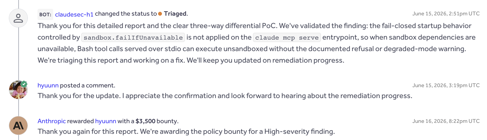

Hello! In this post, I'll explain how I used Claude Code to research Claude Code's security, including the harness I built, the false starts, and a patched vulnerability that earned a bounty.



---

## 1. Idea

I’ve built several harnesses to automate security research. One lesson from that work is that giving an agent an environment where it can find potential bugs matters, but giving it a way to test those bugs against a real target matters even more.

For example, when analyzing a web application, I wouldn’t give an agent only the source code. I’d also provide a running instance of the site and an ordinary user account, then require an end-to-end PoC. Otherwise, the agent might flag a problem in code that cannot be reached in practice, or treat a feature that an ordinary user cannot access as a vulnerability.

### 1.1 Codex Hacked a Samsung TV

I recently came across [Calif’s research](https://calif.io/research/samsung-tv) on finding a Samsung TV vulnerability with Codex. The researchers had built a harness that let Codex test its findings on the actual device.


The harness was relatively simple. The researchers already had a shell with code execution inside the TV’s browser process. They gave Codex the `KantS2` source code corresponding to the TV’s firmware, a controller host that could build ARM binaries and deliver them to the TV, and a way to interact with the live shell on the device.



Codex connected to the controller host over SSH and used `tmux send-keys` to send commands to the existing TV shell. It read the resulting logs, wrote test programs, built them on the controller, and ran them on the TV. It repeated that cycle as the investigation progressed.

Codex’s initial goal was to find a vulnerability that would allow privilege escalation to root on the Samsung TV. The researchers did not prescribe an attack technique. They did, however, steer Codex to verify that a suspected flaw existed in the source, could be reached from the browser user’s security context, and worked on the real TV.

Codex examined the device drivers available to the browser process and found a flaw in `ntksys` that allowed physical memory to be mapped. It then used a small test program to confirm that it could read and write memory, and eventually gained root from the browser shell.

### 1.2 From Samsung TV to Claude Code

The part of Calif’s work that caught my attention was the way it used `tmux` to control the shell.

A typical Bash command runs and returns its output. A shell on a physical device, or another interactive program, often needs to stay running while you interact with it. With `tmux`, an agent can send commands and key presses to an existing session, then inspect the screen and output without starting over each time.

I thought the same approach could work with interactive agents such as Claude Code or Codex.

For example, I could run one Claude Code instance in a separate environment and let another Claude Code instance send it messages through `tmux`, navigate menus with arrow keys, and inspect the results. If the research agent could also change settings files and launch options and create different test environments, it could directly test another agent’s security behavior.

Another striking part of Calif’s research was that it did not rely on multiple agents or an elaborate workflow. The researchers gave a single Codex agent the firmware source and the ability to control and test the TV, then set a goal: find a vulnerability.

They also stepped in when needed. They asked Codex to verify suspected bugs in both the source and the live device, corrected its misunderstandings about the environment, and steered the investigation.

In my previous harnesses, I had assigned discovery, analysis, and validation to different agents or built each stage into a separate workflow. As those systems grew more complex, there was more to maintain. Each agent needed its own prompt, and important context could be lost when one agent handed work to another. When a result was wrong, it was hard to tell which stage had gone off track. Coordination also consumed tokens and time, and stepping in to change direction midway through a fixed workflow was cumbersome.

I was getting tired of managing that complexity. This time, I decided to follow Calif’s example: give a single agent the tools to find and verify vulnerabilities, then let it decide how to use them.

That was the starting point for a harness that would let Claude Code analyze and test another Claude Code instance.

## 2. Building the Harness

The main requirement was that the agent should be free to set up different environments, run the real Claude Code target, and verify the results.

Claude Code has many CLI options, permission settings, project configuration files, and features such as MCP. I wanted the agent to be able to change those settings and run Claude Code under different conditions, rather than limiting it to a few predefined tests.

### 2.1 Harness Architecture

Here is the overall design:



I separated the Claude Code instance doing the research from the Claude Code instance being tested.

I installed the target instance in a Docker container and built a CLI tool called `clab` to serve a role similar to the controller host in Calif’s research. With `clab`, the research agent can set up test environments inside Docker, launch the target Claude Code instance, and interact with it.

I also provided material for analyzing Claude Code’s implementation and a place to record test results and vulnerability candidates.

The emphasis was on giving the agent an environment where it could investigate and run experiments itself, without building a complex discovery and validation workflow around it.

### 2.2 clab CLI

I built `clab` to make the test environment easier to manage and control.

To keep the harness simple, I did not build separate features for creating or editing files. The agent could use Bash inside the Docker container for that.

`clab` has two main concepts:

- **Case:** Creates a test environment and manages its workspace and Claude Code settings.
- **Session:** Runs Claude Code, sends messages and key presses through `tmux`, and retrieves the screen output and logs.

```text
$ clab -h
usage: clab [-h] COMMAND ...

Controlled Claude Code experiments with durable logs and file evidence.

options:
  -h, --help     show this help message and exit

Commands:
  COMMAND
    init         initialize this project and start or reconcile its container
    attach       attach directly to a case's active Claude tmux session
    case         create, prepare, inspect, and reset case worktrees
    session      start and control Claude runs; inspect screens, status, and logs
    login        log in the shared Claude test account
    auth-status  check shared authentication

Project:
  init                                       Initialize this project and its container

Authentication:
  login                                      Log in the shared Claude test account
  auth-status                                Check shared authentication status

Case management:
  case new CASE                              Create an empty case
  case import CASE HOST_DIR                  Import prepared directory contents
  case shell CASE                            Open Bash in a case
  case exec CASE -- COMMAND [ARG...]         Run a command inside a case
  case list                                  List cases and active-run counts
  case reset CASE                            Restore the imported baseline

Sessions:
  attach CASE [--run-id RUN_ID]              Attach to the case's active tmux session
  session start CASE -- [CLAUDE_ARG...]      Start Claude asynchronously
  session list [CASE] [--all]                List active or historical runs
  session status CASE [--run-id RUN_ID]         Show run state and actual exit result
  session screen CASE [--run-id RUN_ID] [--history N]
                                              Show a live tmux screen
  session type CASE [--run-id RUN_ID] -- TEXT   Paste literal text without Enter
  session key CASE [--run-id RUN_ID] KEY [--repeat N]
                                              Send a validated key
  session attach CASE [--run-id RUN_ID]         Attach to the Claude tmux session
  session logs CASE [--run-id RUN_ID] [--follow] [--raw]
                                              Read a terminal-safe durable log
  session stop CASE [--run-id RUN_ID]           Stop Claude and finalize evidence

Examples:
  clab init
  clab login
  clab case new demo
  RUN_ID=$(clab session start demo -- -p 'Analyze this project')
  clab attach demo --run-id "$RUN_ID"
  clab session status demo --run-id "$RUN_ID"
  clab session logs demo --run-id "$RUN_ID"

Run 'clab COMMAND --help' for command-specific help.
```

Each case has its own workspace and settings directory. A case can also run multiple Claude Code sessions at once.

`clab` passes any CLI arguments supplied when starting Claude Code directly to the target. This let the agent test different permission settings, MCP options, and other launch conditions.

Here is the research agent using `clab` to launch and control another Claude Code session:



I also wrote an Agent Skill so the research agent would use `clab` correctly.

````text
---
name: clab
description: Operate, explain, troubleshoot, or interpret evidence
  from the clab Docker/tmux harness for controlled Claude Code experiments.
---

# Clab

Use `clab` as an execution and evidence harness.
It is neither a case isolation boundary nor an attribution oracle.

## Run an experiment

```bash
clab case new demo
clab case import demo ./prepared
RUN_ID=$(clab session start demo -- -p 'Analyze this project')
clab session status demo --run-id "$RUN_ID"
clab session logs demo --run-id "$RUN_ID"
```

Critical rules:

- Everything after `session start CASE --` is the exact Claude argv.
- A successful `start` means launch succeeded.
  Use `status` for Claude's actual exit result.
- `type` pastes literal UTF-8 without Enter.
  Send Enter separately with `session key`.

...
````

This gave the agent a way to set up test environments and interact with Claude Code. I left the actual investigation and validation decisions to the agent.

### 2.3 Understanding the Target

The test environment was only part of the setup. The agent also needed material it could use to analyze Claude Code’s internals.

Calif had supplied the `KantS2` source code corresponding to the Samsung TV firmware so Codex could inspect the driver implementation and look for vulnerabilities. Claude Code’s full source is not public, so I instead instructed the agent to download and analyze the Claude Code package published on npm.

```bash
npm pack @anthropic-ai/claude-code@<VERSION>
```

The agent could obtain the package for whichever version it needed, reverse engineer the bundled code or executable, and compare versions.

As the research progressed, I also provided published 1-day vulnerability reports and the official Claude Code documentation.

## 3. Guiding the Agent

### 3.1 Setting the Goal

Once the harness was in place, I needed to decide what goal to give the agent and how to guide it in using the environment.

In Calif’s research, Codex was initially tasked with finding a privilege escalation vulnerability that would yield root access on a Samsung TV. As the investigation progressed, the researchers provided additional prompts explaining how to validate findings and use the SSH and `tmux` setup.

I took a similar approach, but provided the Goal and supporting instructions from the start so that the agent could continue investigating on its own.

Putting everything in the Goal would have made the prompt unwieldy, so I split the instructions by purpose:

- Goal: the research objective and criteria for success
- `CLAUDE.md`: the research environment, code analysis methods, and vulnerability validation principles
- `SCOPE.md`: the Anthropic Bug Bounty program’s in-scope and out-of-scope rules
- `clab` Skill: how to use the harness and interpret its results

The detailed environment and usage instructions lived in separate documents. I tried to keep the Goal focused on what the agent needed to accomplish and what would count as a successful result.

Calif’s research had a specific objective: obtain root on the physical TV. I did not restrict this investigation to a particular vulnerability class or attack technique. Instead, the goal was to find one new vulnerability within the Anthropic Bug Bounty scope and reproduce and validate it on the actual target.

The initial Goal was:

```
Find and validate at least one previously unknown security vulnerability in Claude Code that falls within the Anthropic Bug Bounty scope.

Follow CLAUDE.md and SCOPE.md. Independently investigate Claude Code using the available research materials, code analysis tools, and clab test environment.

A finding is successful only if you can reproducibly demonstrate a genuine security boundary violation on the actual Claude Code target, with realistic attacker-controlled conditions and observable security impact.

Do not treat intended functionality, explicitly authorized behavior, out-of-scope issues, or known vulnerabilities as successful findings. Verify the affected version, required conditions, and actual behavior rather than relying on speculation or source analysis alone.

Once a valid finding is confirmed, prepare a detailed vulnerability report with reproduction steps, supporting evidence, and security impact for human review. Do not submit reports automatically.

Continue investigating until a valid finding is confirmed. If an approach fails, revise your hypotheses and explore alternative attack surfaces.
```

With the Goal and basic instructions in place, I left the specific search strategy and experiments up to Claude Code.

### 3.2 Initial Findings

After a few hours of investigation under the initial Goal, the agent began producing candidates. It analyzed the code, set up test environments, and reproduced the behavior it found. I reviewed several of these candidates and submitted them to Anthropic, but most were closed as Informative because Anthropic considered the behavior intentional.

One example involved a project’s `SessionStart` Hook running immediately after Workspace Trust was approved, without a separate prompt to approve the command. If someone cloned a malicious repository, launched Claude Code, and trusted the folder, a command defined by that project could run with the user’s privileges.

My concern was that the trust prompt did not separately warn about the Hook, so users could trust a folder without knowing what command would run. Anthropic responded that trusting the folder also meant trusting its project settings and Hooks.



The *TrustFall* research covered by SK Shieldus raised a similar issue: a project’s MCP server could start automatically after the user approved folder trust. Anthropic also considered the behavior in that case to be intentional.

Three other reports were closed as Informative for similar reasons. These responses made me realize that I needed a clearer understanding of what Anthropic considered part of the user’s approval and what it would recognize as a violation of a security boundary.

### 3.3 Changing the Approach

After reviewing the Informative decisions, I changed the direction of the investigation. Reproducing unexpected behavior was not enough; I needed a way to determine whether that behavior actually crossed a security boundary.

I organized publicly available reports on known Claude Code vulnerabilities and the official documentation locally for the agent. The accepted vulnerabilities provided examples of root causes and demonstrated impact. The documentation helped establish how features were intended to work and what the security settings promised to enforce.

I revised the Goal as well. The agent could use the root causes of known vulnerabilities and the security guarantees described in the documentation as leads for new findings. It also had to consult both sources when validating a candidate, checking whether the behavior was already reported or intended. The revised Goal was:

```
Find and validate one previously unreported security vulnerability in Claude Code that is eligible under the Anthropic Bug Bounty scope.

Read `CLAUDE.md` and `SCOPE.md` before investigating. Use the available `clab` test environment, code analysis tools, known vulnerability reports in `1day/`, and official documentation in `claude-code-docs/`.

Independently investigate the target. Study known vulnerability root causes and compare documented security guarantees with actual behavior, but do not limit your investigation to these approaches.

A finding counts as valid only when a reproducible test on the actual Claude Code target demonstrates a genuine security boundary violation under realistic attacker-controlled conditions. Demonstrate the required attacker capabilities rather than assuming privileged access or user authorization.

Before accepting a finding, check for known vulnerabilities and duplicates, confirm that it is not intended or explicitly authorized behavior, and verify that it satisfies `SCOPE.md`.

Run the reproduction and show the observable results from `clab`, including relevant execution logs, target version, configuration, and demonstrated security impact. Do not weaken or modify security checks or test conditions to manufacture success.

Continue investigating until one valid vulnerability is confirmed. If an approach fails or reaches a dead end, analyze the results, revise your hypotheses, and explore alternative attack surfaces. Do not stop merely because previous attempts were unsuccessful.

Once a valid finding is confirmed, prepare a detailed vulnerability report with reproduction steps and supporting evidence for independent human review. Do not submit reports automatically
```

From this point on, I also took a more active part in the analysis. I reviewed Anthropic’s responses with the agent to understand why the reports had not been accepted, checked the conditions behind its new candidates, and suggested where to look next. In particular, I asked it to examine **whether security behavior promised in the official documentation was enforced across the relevant code paths**.

## 4. The Finding

### 4.1 Discovery and Validation

As the research continued, I asked the agent to compare the security behavior described in the documentation with the actual implementation. While examining the sandbox settings for `claude mcp serve`, it found that `sandbox.failIfUnavailable` was not being enforced.

The `claude mcp serve` command runs Claude Code as a stdio MCP server. Another MCP client can connect to it and call Claude Code tools such as Bash.

Claude Code can be configured to enable the sandbox and exit with an error if the sandbox cannot start:

```
{
  "sandbox": {
    "enabled": true,
    "failIfUnavailable": true
  }
}
```

Here, `enabled` requests sandboxing, while `failIfUnavailable` requires Claude Code to exit if the sandbox cannot start. It is a fail-closed policy: if the protection cannot be applied, execution should stop.

When the agent compared the startup paths, it found a check that refuses to start normal sessions when the sandbox is required but unavailable. The corresponding check was absent from the MCP server startup path. I then tested whether that difference affected the actual behavior.

I used `clab` to run Claude Code `2.1.172` on Linux, varying whether the sandbox dependencies were available. For the MCP server tests, I connected a separate stdio client, called the Bash tool, and checked whether it created a marker file.

| Test condition | Observed result |
| --- | --- |
| `claude -p` with sandbox dependencies unavailable | Exited with an error stating that the sandbox was required |
| `claude mcp serve` with sandbox dependencies unavailable | Ran Bash and created the marker file |
| `claude mcp serve` with sandbox dependencies available | Blocked the write to the marker file |

The following screenshot shows `claude -p` refusing to start when the sandbox dependencies were unavailable.



Under the same conditions, `claude mcp serve` ran the Bash command and created the marker file.



Once the sandbox dependencies were available, the Bash command sent to the MCP server failed with a `Read-only file system` error, and the marker file was not created.



### 4.2 Root Cause Analysis

The cause was a missing sandbox-required check in the MCP server’s startup path.

The code below is excerpted from source recovered using the source map in the `2.1.88` npm package. The reproduction used `2.1.172`, whose distributed code showed the same MCP call structure and missing check.

In `src/cli/print.ts`, the startup path for `claude -p` checks why the sandbox is unavailable. If the configuration requires the sandbox, the following branch prints an error and exits. The interactive startup path in `screens/REPL.tsx` has a check for the same purpose.

```tsx
if (SandboxManager.isSandboxRequired()) {
  process.stderr.write(
    `\nError: sandbox required but unavailable: ${sandboxUnavailableReason}\n` +
      `  sandbox.failIfUnavailable is set — refusing to start without a working sandbox.\n\n`,
  )
  gracefulShutdownSync(1)
  return
}
```

By contrast, the MCP server startup path in `src/cli/handlers/mcp.tsx` calls `setup()` and then proceeds to `startMCPServer()`. Neither that startup path nor `setup()` contains the sandbox-required check used in the normal startup paths.

```tsx
const { setup } = await import('../../setup.js')

await setup(providedCwd, 'default', false, false, undefined, false)

const { startMCPServer } = await import('../../entrypoints/mcp.js')

await startMCPServer(providedCwd, debug ?? false, verbose ?? false)
```

When the Bash tool later decides whether to sandbox a command, the dependency check causes `isSandboxingEnabled()` to return `false` if dependencies are missing. `shouldUseSandbox()` then returns `false` as well.

```tsx
// sandbox-adapter.ts — relevant portion of isSandboxingEnabled()
if (checkDependencies().errors.length > 0) {
  return false
}

// shouldUseSandbox.ts — relevant portion of shouldUseSandbox()
if (!SandboxManager.isSandboxingEnabled()) {
  return false
}
```

These functions determine **whether the sandbox is available**. They do not decide **whether execution must stop** when `failIfUnavailable` is set. In normal sessions, the startup check handles that requirement. Because the MCP server path lacked the check, a Bash command could run without sandboxing after `shouldUseSandbox()` returned `false`.

## 5. Conclusion

I reported the issue to Anthropic on June 11, 2026. It was accepted as High severity, and I received a $3,500 bounty. The vulnerability was subsequently fixed in `2.1.196`.



This research reminded me how much it matters to give an agent a harness that lets it **run the actual target, change the conditions, and inspect the results**. Once `clab` made those steps possible, Claude Code could investigate the code, form hypotheses, and carry out experiments on its own.

Of the 20 reports I submitted during the research, one was accepted, two were marked Duplicate, and 17 were closed as Informative. The agent could run the experiments, but I found that judging why a result constituted a vulnerability—and deciding where to look next—still required some understanding of the target on my part. The accepted finding came after I suggested comparing what the documentation promised with what the different execution paths actually did.

I would like to try this approach on other projects next. I plan to keep improving the harness so I can follow what the agent tried and what happened, then step in to steer the investigation when needed.
