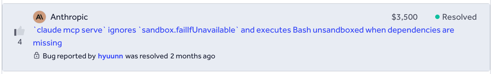
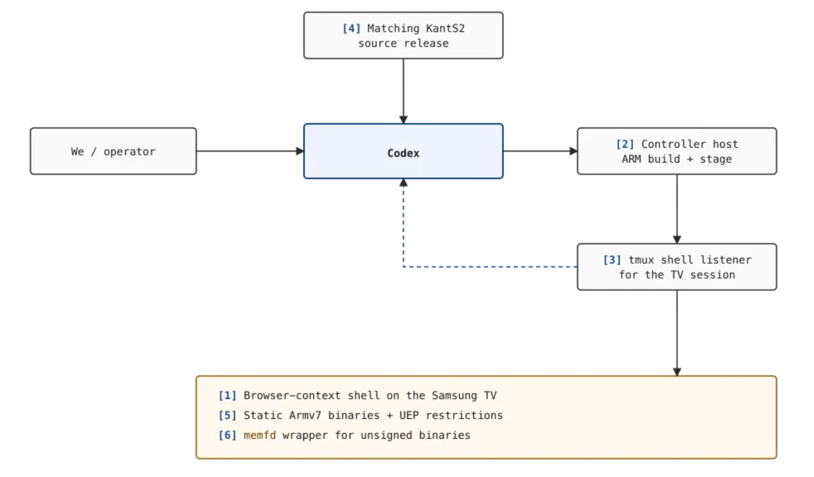
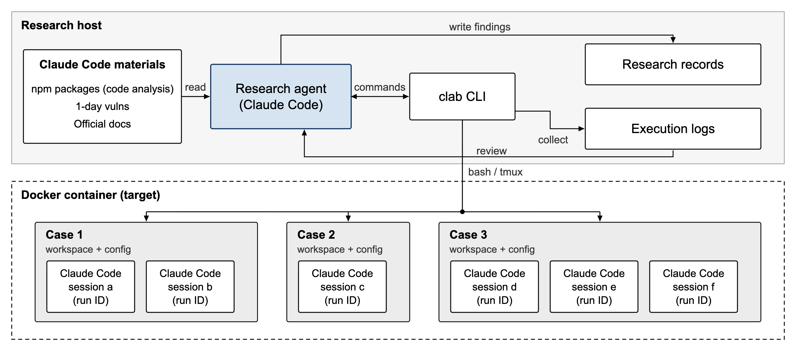
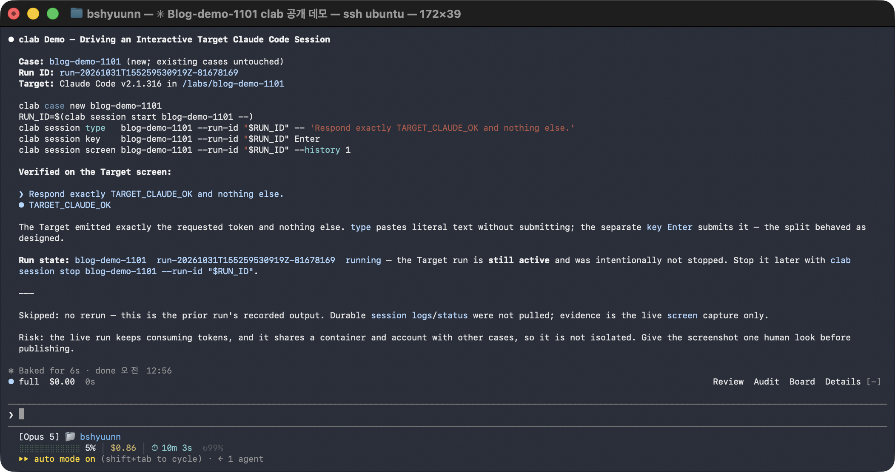
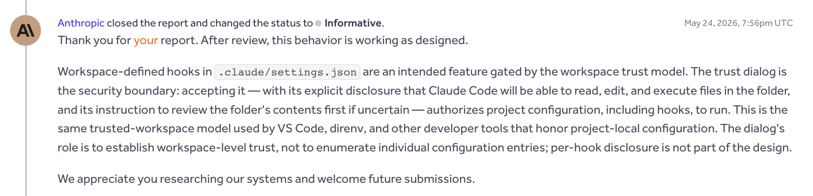
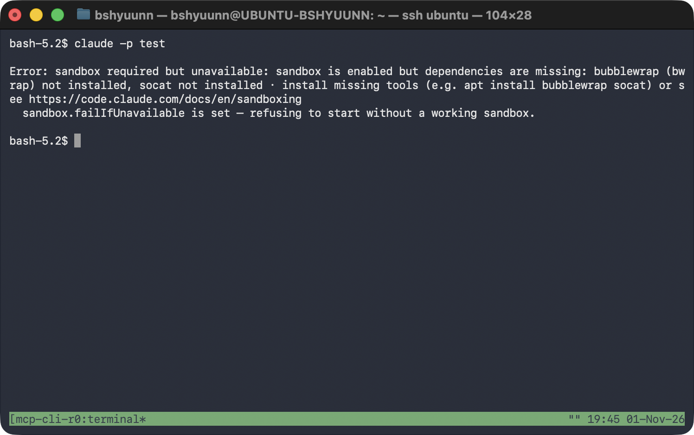
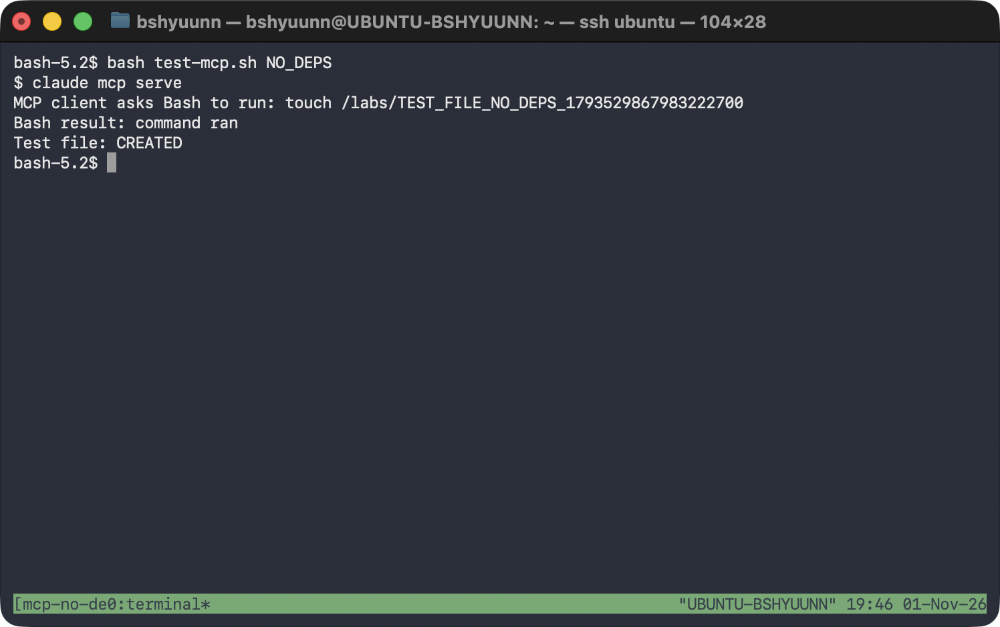
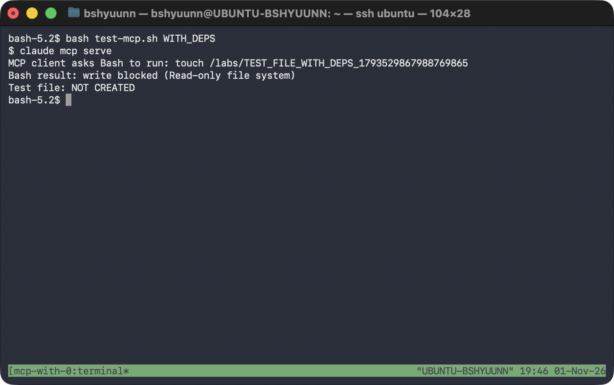
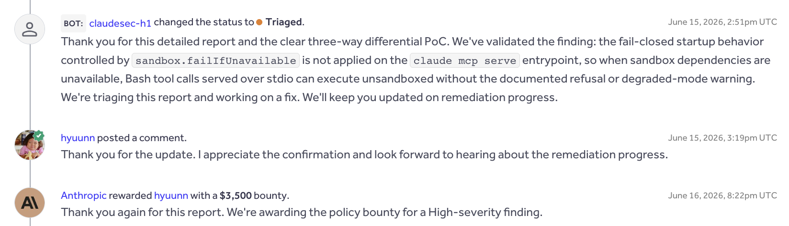

안녕하세요! 최근 Claude Code를 대상으로 취약점 분석을 진행하고 있으며, 그 과정에서 취약점 하나를 인정받아 바운티를 받았습니다.



재밌는 점은 취약점을 찾는 과정의 대부분을 Claude Code 자체를 이용하여 진행했습니다.

이번 글에서는 Claude Code가 Claude Code의 취약점을 찾을 수 있도록 어떤 식으로 하네스를 구성했는지, 그 과정에서 어떤 시행착오를 겪었는지, 그리고 최근 제보한 취약점이 패치되어, 최종적으로 발견한 취약점에 대해서도 정리해보려고 합니다.

---

## 1. Idea

저는 해킹을 자동화하기 위해 이전부터 여러 하네스를 만들어봤습니다. 이 과정에서 느낀 점은 에이전트가 취약점을 찾을 수 있는 환경도 중요하지만, 발견한 취약점을 실제로 검증할 수 있는 환경과 가이드를 제공하는 것이 더 중요하다는 것이었습니다.

예를 들어 웹 취약점을 분석할 때는 소스 코드만 제공하는 것이 아니라 실제로 배포된 웹사이트와 일반 사용자 계정을 제공하고, End-to-End PoC를 통해 취약점이 재현되는지 확인하도록 해야 합니다. 그렇지 않으면 실제로는 도달할 수 없는 코드에서 문제를 찾거나, 일반 사용자 권한으로는 접근조차 할 수 없는 기능을 취약점으로 판단하는 경우가 생깁니다.

### 1.1. Codex Hacked a Samsung TV

최근에는 이처럼 하드웨어 환경에서 취약점을 검증할 수 있는 하네스를 구성해, Codex로 Samsung TV의 취약점을 발견한 Calif의 연구를 보게 되었습니다. 글은 Calif의 블로그에서 확인할 수 있습니다.

- [Codex Hacked a Samsung TV - Calif](https://blog.calif.io/p/codex-hacked-a-samsung-tv)

Calif에서는 Codex가 Samsung TV의 취약점을 직접 탐색하고 검증할 수 있도록 비교적 단순한 하네스를 구성했습니다.

먼저 연구에서는 Samsung TV의 브라우저에서 코드 실행이 가능한 셸을 확보한 상태였습니다. 여기에 TV의 펌웨어와 대응되는 `KantS2` 소스 코드, ARM 바이너리를 빌드하고 TV에 전달할 수 있는 Controller Host, 그리고 실제 TV의 셸을 조작할 수 있는 환경을 제공했습니다.



Codex는 Controller Host에 SSH로 접속하고, `tmux send-keys`를 이용해 이미 연결되어 있는 TV 셸에 명령을 전달했습니다. 그리고 실행 결과를 로그로 확인하면서 필요한 테스트 코드를 작성하고, Controller에서 빌드한 뒤 TV에서 실행하는 과정을 반복했습니다.

이때 Codex에게 주어진 최초 목표는 Samsung TV에서 root 권한 상승이 가능한 취약점을 찾는 것이었습니다. 구체적으로 어떤 공격 기법을 사용하라고는 명시하지 않았습니다. 대신 코덱스가 직접 소스 코드에 취약점이 실제로 존재하는지, 브라우저 사용자 권한에서 접근할 수 있는지, 실제 TV에서도 재현되는지를 철저히 검증하도록 추가로 지시했습니다.

이 과정에서 Codex는 접근 가능한 디바이스 드라이버들을 조사하고, `ntksys` 드라이버에서 물리 메모리를 매핑할 수 있는 문제를 발견했습니다. 이후 작은 테스트 프로그램으로 실제 메모리 읽기와 쓰기가 가능한지 확인했고, 최종적으로 브라우저 셸에서 root 권한을 획득하는 데 성공했습니다.

### 1.2. From Samsung TV to Claude Code

Calif의 연구에서 특히 눈에 들어왔던 부분은 `tmux`를 이용한 셸 제어 방식이었습니다.

일반적인 Bash 명령은 실행 후 결과를 반환받는 방식이지만, 실제 장비의 셸이나 대화형 프로그램은 하나의 세션을 유지하면서 계속 상호작용해야 하는 경우가 있습니다. `tmux`를 이용하면 이미 실행 중인 세션에 명령이나 키 입력을 보내고, 세션을 유지한 상태에서 화면과 실행 결과를 확인할 수 있습니다.

저는 이 방식이 Samsung TV 같은 하드웨어뿐만 아니라 Claude Code나 Codex 같은 대화형 에이전트에도 적용할 수 있을 것 같다는 생각을 했습니다.

예를 들어 Claude Code를 별도의 환경에서 실행하고, 다른 Claude Code가 `tmux`를 이용해 메시지를 보내거나 방향키로 메뉴를 조작하고, 실행 결과를 확인하도록 만드는 것입니다. 여기에 설정 파일이나 실행 옵션을 자유롭게 변경하고 여러 테스트 환경을 만들 수 있게 한다면, 에이전트가 다른 에이전트의 다양한 보안 동작을 직접 테스트해볼 수 있을 것 같았습니다.

또 하나 흥미로웠던 점은 멀티 에이전트나 복잡한 워크플로를 사용하지 않았다는 것입니다. 순수 Codex 하나에 Samsung TV를 직접 조작하고 테스트할 수 있는 환경과 펌웨어 소스 코드를 제공한 뒤, 취약점을 찾아보라는 목표를 주었습니다.

그리고 연구자가 중간중간 직접 개입해 소스 코드와 실제 장비에서 취약점이 존재하는지 철저히 검증하도록 지시하거나, 실행 환경을 잘못 이해했을 때 바로잡아주는 등 연구 방향을 잡아주었습니다.

저는 이전까지 여러 에이전트에게 취약점 탐색, 분석, 검증 등의 역할을 나눠주거나 각 단계를 별도의 워크플로로 구성하는 하네스를 만들어왔습니다. 하지만 구조가 복잡해질수록 관리해야 할 부분도 많아졌습니다. 각 에이전트의 프롬프트를 따로 관리해야 했고, 한 에이전트가 발견한 내용을 다음 에이전트에게 전달하는 과정에서 중요한 컨텍스트가 누락되기도 했습니다. 결과가 잘못되었을 때도 어느 단계에서 문제가 발생했는지 파악하고 수정하기가 쉽지 않았습니다. 또한 에이전트 간의 결과를 전달하고 조율하는 과정에서 불필요한 토큰과 시간이 사용되었고, 정해진 워크플로 중간에 직접 개입해 연구 방향을 바꾸기도 번거로웠습니다.

이런 과정을 반복하면서 복잡한 하네스를 관리하는 데 조금 질려 있었기 때문에 이번에는 별도의 복잡한 워크플로를 구현하기보다, Calif의 사례처럼 순수 에이전트에 취약점을 찾고 검증할 수 있는 하네스만 제공하고 나머지는 에이전트에게 맡겨보자고 생각했습니다.

이렇게 Claude Code가 다른 Claude Code를 직접 분석하고 테스트할 수 있는 하네스를 만들기 시작했습니다.

<br>

## 2. Building the Harness

하네스를 구성하면서 가장 중요하게 생각한 것은 에이전트가 다양한 환경을 자유롭게 구성하고, 실제 Claude Code를 실행해 결과를 검증할 수 있어야 한다는 점이었습니다.

Claude Code에는 다양한 CLI 옵션과 권한 설정, 프로젝트 설정 파일, MCP 등의 기능이 있습니다. 따라서 특정 기능만 테스트할 수 있도록 제한하기보다는 에이전트가 직접 설정을 변경하고, 다양한 조건에서 Claude Code를 실행할 수 있도록 구성했습니다.

### 2.1. Harness Architecture

전체 하네스 구조는 다음과 같습니다.



먼저 연구를 수행하는 Claude Code와 테스트 대상 Claude Code의 실행 환경을 분리했습니다.

테스트 대상 Claude Code는 하나의 Docker 컨테이너 내부에 설치하고, Calif 연구의 Controller Host와 비슷한 역할을 할 수 있도록 `clab`이라는 CLI 도구를 만들었습니다. 이를 통해 연구 에이전트가 Docker 내부의 테스트 환경을 구성하고, Claude Code를 직접 실행하고 조작할 수 있습니다.

또한 Claude Code의 내부 구현을 분석할 수 있는 자료를 제공하고, 실제 테스트 결과와 취약점 후보를 기록할 수 있는 환경도 구성했습니다.

전체적으로 취약점 탐색이나 검증을 위한 복잡한 워크플로를 별도로 구현하기보다는, 에이전트가 직접 분석하고 실험할 수 있는 환경을 제공하는 데 집중했습니다.

### 2.2. clab CLI

이러한 테스트 환경을 쉽게 관리하고 조작할 수 있도록 만든 것이 `clab` CLI입니다.

하네스가 복잡해지는 것을 피하기 위해 파일 생성이나 수정 등의 기능은 별도로 구현하지 않고, Docker 내부의 Bash를 직접 사용할 수 있도록 했습니다.

`clab`은 크게 `case`와 `session` 두 가지 기능으로 구성했습니다.

- Case: 테스트 환경을 생성하고, Workspace와 Claude Code 설정을 관리하는 기능
- Session: Claude Code를 실행하고, `tmux`를 통해 메시지나 키 입력을 전달하고 실행 결과를 확인하는 기능

```
$ clab -h
usage: clab [-h] COMMAND ...

Controlled Claude Code experiments with durable logs and file evidence.

options:
  -h, --help     show this help message and exit

Commands:
  COMMAND
    init         initialize this project and start or reconcile its container
    attach       attach directly to a case's active Claude tmux session
    case         create, prepare, inspect, and reset case worktrees
    session      start and control Claude runs; inspect screens, status, and logs
    login        log in the shared Claude test account
    auth-status  check shared authentication

Project:
  init                                       Initialize this project and its container

Authentication:
  login                                      Log in the shared Claude test account
  auth-status                                Check shared authentication status

Case management:
  case new CASE                              Create an empty case
  case import CASE HOST_DIR                  Import prepared directory contents
  case shell CASE                            Open Bash in a case
  case exec CASE -- COMMAND [ARG...]         Run a command inside a case
  case list                                  List cases and active-run counts
  case reset CASE                            Restore the imported baseline

Sessions:
  attach CASE [--run-id RUN_ID]              Attach to the case's active tmux session
  session start CASE -- [CLAUDE_ARG...]      Start Claude asynchronously
  session list [CASE] [--all]                List active or historical runs
  session status CASE [--run-id RUN_ID]         Show run state and actual exit result
  session screen CASE [--run-id RUN_ID] [--history N]
                                              Show a live tmux screen
  session type CASE [--run-id RUN_ID] -- TEXT   Paste literal text without Enter
  session key CASE [--run-id RUN_ID] KEY [--repeat N]
                                              Send a validated key
  session attach CASE [--run-id RUN_ID]         Attach to the Claude tmux session
  session logs CASE [--run-id RUN_ID] [--follow] [--raw]
                                              Read a terminal-safe durable log
  session stop CASE [--run-id RUN_ID]           Stop Claude and finalize evidence

Examples:
  clab init
  clab login
  clab case new demo
  RUN_ID=$(clab session start demo -- -p 'Analyze this project')
  clab attach demo --run-id "$RUN_ID"
  clab session status demo --run-id "$RUN_ID"
  clab session logs demo --run-id "$RUN_ID"

Run 'clab COMMAND --help' for command-specific help.
```

각 Case는 별도의 Workspace와 설정 디렉터리를 가지며, 하나의 Case에서 여러 Claude Code 세션을 동시에 실행할 수도 있습니다.

또한 Claude Code를 실행할 때 원하는 CLI 인자를 그대로 전달할 수 있도록 하여, 에이전트가 권한 설정이나 MCP 등 다양한 옵션을 자유롭게 변경하며 테스트할 수 있게 했습니다.

실제로 연구 에이전트가 `clab`을 이용해 다른 Claude Code 세션을 실행하고 조작하는 모습은 다음과 같습니다.



추가로 에이전트가 `clab`을 올바르게 사용할 수 있도록 Agent Skill도 작성했습니다.

````text

---
name: clab
description: Operate, explain, troubleshoot, or interpret evidence
  from the clab Docker/tmux harness for controlled Claude Code experiments.
---

# Clab

Use `clab` as an execution and evidence harness.
It is neither a case isolation boundary nor an attribution oracle.

## Run an experiment

```bash
clab case new demo
clab case import demo ./prepared
RUN_ID=$(clab session start demo -- -p 'Analyze this project')
clab session status demo --run-id "$RUN_ID"
clab session logs demo --run-id "$RUN_ID"
```

Critical rules:

- Everything after `session start CASE --` is the exact Claude argv.
- A successful `start` means launch succeeded.
  Use `status` for Claude's actual exit result.
- `type` pastes literal UTF-8 without Enter.
  Send Enter separately with `session key`.

...
````

이렇게 에이전트가 직접 테스트 환경을 구성하고 Claude Code와 상호작용할 수 있도록 하되, 취약점 탐색과 검증 과정 자체는 에이전트에게 맡기도록 했습니다.

### 2.3. Understanding the Target

테스트 환경 외에도 Claude Code의 내부 구현을 분석할 수 있는 자료가 필요했습니다.

Calif에서는 Samsung TV의 펌웨어에 대응하는 `KantS2` 소스 코드를 제공하여, Codex가 실제 드라이버 구현을 분석하고 취약점을 찾을 수 있도록 했습니다. 하지만 Claude Code는 전체 소스 코드가 공개되어 있지 않기 때문에, npm에 배포된 Claude Code 패키지를 내려받아 분석하도록 지시했습니다.

```bash
npm pack @anthropic-ai/claude-code@<VERSION>
```

이를 통해 에이전트가 필요한 버전의 배포 패키지를 직접 확보하고, 리버싱을 통해 번들링된 코드나 실행 파일을 분석하거나 버전 간 차이를 비교할 수 있도록 했습니다.

추가로 연구를 진행하면서 기존에 공개된 1-day 취약점 자료와 Claude Code 공식 문서도 함께 제공했습니다.

<br>

## 3. Guiding the Agent

### 3.1. Setting the Goal

하네스를 구성한 다음에는 에이전트에게 어떤 목표를 주고, 이 환경을 어떻게 활용하도록 안내할 것인지도 중요합니다.

Calif의 연구에서는 처음에 Samsung TV에서 root 권한 상승 취약점을 찾으라는 목표를 주고, 이후 연구를 진행하면서 검증 방법이나 SSH, tmux 등의 환경 사용법을 추가 프롬프트로 단계적으로 안내했습니다.

저도 비슷하게 프롬프팅을 통해 연구를 진행하도록 했지만, 처음부터 Goal과 관련 지침들을 함께 제공하여 에이전트가 스스로 연구를 이어갈 수 있도록 구성했습니다.

다만 모든 내용을 Goal에 포함하면 프롬프트가 지나치게 길어질 수 있기 때문에, 각각의 역할을 다음과 같이 분리했습니다.

- Goal: 최종 연구 목표와 성공 조건
- CLAUDE.md: 연구 환경, 코드 분석 방법, 취약점 검증 원칙
- SCOPE.md: Anthropic Bug Bounty의 In Scope 및 Out of Scope 규칙
- clab Skill: 하네스의 사용 방법과 실행 결과 해석 방법

이렇게 구체적인 환경 설명과 사용 방법은 별도의 문서로 분리하고, Goal에는 에이전트가 최종적으로 달성해야 할 목표와 성공 조건만 간결하게 정의하려고 했습니다.

Calif의 연구에서는 실제 TV에서 root 권한을 획득한다는 명확한 목표가 있었지만, 이번 연구에서는 특정 취약점 유형이나 공격 방법을 제한하지 않았습니다. 대신 Anthropic Bug Bounty Scope에 해당하는 새로운 취약점 하나를 발견하고, 실제 환경에서 재현 및 검증하는 것을 목표로 설정했습니다.

처음 사용한 Goal은 다음과 같습니다.

```
Find and validate at least one previously unknown security vulnerability in Claude Code that falls within the Anthropic Bug Bounty scope.

Follow CLAUDE.md and SCOPE.md. Independently investigate Claude Code using the available research materials, code analysis tools, and clab test environment.

A finding is successful only if you can reproducibly demonstrate a genuine security boundary violation on the actual Claude Code target, with realistic attacker-controlled conditions and observable security impact.

Do not treat intended functionality, explicitly authorized behavior, out-of-scope issues, or known vulnerabilities as successful findings. Verify the affected version, required conditions, and actual behavior rather than relying on speculation or source analysis alone.

Once a valid finding is confirmed, prepare a detailed vulnerability report with reproduction steps, supporting evidence, and security impact for human review. Do not submit reports automatically.

Continue investigating until a valid finding is confirmed. If an approach fails, revise your hypotheses and explore alternative attack surfaces.
```

이렇게 Goal과 기본 지침들을 제공한 뒤, 구체적인 취약점 탐색 방법과 실험 과정은 Claude Code가 스스로 결정하도록 했습니다.

### 3.2. Initial Findings

초기 Goal로 몇 시간 동안 취약점 탐색을 진행하자 여러 후보가 나오기 시작했습니다. 에이전트는 코드를 분석하고 테스트 환경을 구성해 동작을 재현했으며, 저도 그중 몇 가지를 검토해 Anthropic에 제보했습니다. 하지만 대부분은 Intended Design이라는 이유로 Informative 처리되었습니다.

대표적인 사례는 Workspace Trust 승인 직후 프로젝트의 `SessionStart` Hook이 별도의 명령 실행 승인 없이 실행되는 동작이었습니다. 악성 리포지토리를 클론한 사용자가 Claude Code를 실행하고 폴더 신뢰를 승인하면, 프로젝트에 설정된 명령이 사용자 권한으로 실행될 수 있었습니다.

저는 Hook에 대한 별도 경고가 없어 사용자가 어떤 명령이 실행될지 모른 채 폴더를 신뢰할 수 있다는 점을 문제로 봤습니다. 하지만 Anthropic은 폴더 신뢰 승인에 프로젝트 설정과 Hook 실행에 대한 신뢰도 포함된다고 답변했습니다.



SK쉴더스가 소개한 [*TrustFall* 연구](https://www.skshieldus.com/security-insights/trends/trustfall-ai-coding-cli-mcp-rce?utm_source=chatgpt.com)에서도 폴더 신뢰 승인 뒤 프로젝트의 MCP 서버가 자동 실행되는 유사한 문제를 다뤘습니다. TrustFall 사례 역시 Anthropic은 의도된 동작으로 판단했습니다.

이 밖에도 비슷한 이유로 보고서 3건이 Informative로 종결되었습니다. 이 경험을 통해 Anthropic이 어디까지를 사용자의 승인 범위로 보고, 어떤 동작을 보안 경계 위반으로 인정하는지 더 정확히 이해할 필요가 있음을 알게 되었습니다.

### 3.3. Changing the Approach

Informative로 처리된 제보를 검토하면서 탐색 방향을 바꿨습니다. 예상과 다른 동작을 재현하는 것만으로는 부족했고, 그 동작이 실제 보안 경계를 위반하는지 확인할 기준이 필요했습니다.

그래서 공개된 Claude Code의 1-day 취약점 자료와 공식 문서를 로컬에 정리해 제공했습니다. 이미 인정된 취약점에서는 Root Cause와 영향을 참고하고, 공식 문서에서는 기능의 의도된 동작과 보안 설정이 보장하는 범위를 확인하도록 했습니다.

Goal도 이에 맞춰 수정했습니다. 기존 1-day 취약점의 원인과 공식 문서의 보안 설명을 새로운 취약점을 찾는 단서로 활용하고, 후보가 나온 뒤에도 두 자료를 참고해 중복 제보나 의도된 동작은 아닌지 검증하도록 했습니다. 실제 수정한 Goal은 다음과 같습니다.

```
Find and validate one previously unreported security vulnerability in Claude Code that is eligible under the Anthropic Bug Bounty scope.

Read `CLAUDE.md` and `SCOPE.md` before investigating. Use the available `clab` test environment, code analysis tools, known vulnerability reports in `1day/`, and official documentation in `claude-code-docs/`.

Independently investigate the target. Study known vulnerability root causes and compare documented security guarantees with actual behavior, but do not limit your investigation to these approaches.

A finding counts as valid only when a reproducible test on the actual Claude Code target demonstrates a genuine security boundary violation under realistic attacker-controlled conditions. Demonstrate the required attacker capabilities rather than assuming privileged access or user authorization.

Before accepting a finding, check for known vulnerabilities and duplicates, confirm that it is not intended or explicitly authorized behavior, and verify that it satisfies `SCOPE.md`.

Run the reproduction and show the observable results from `clab`, including relevant execution logs, target version, configuration, and demonstrated security impact. Do not weaken or modify security checks or test conditions to manufacture success.

Continue investigating until one valid vulnerability is confirmed. If an approach fails or reaches a dead end, analyze the results, revise your hypotheses, and explore alternative attack surfaces. Do not stop merely because previous attempts were unsuccessful.

Once a valid finding is confirmed, prepare a detailed vulnerability report with reproduction steps and supporting evidence for independent human review. Do not submit reports automatically
```

또한 이때부터는 저도 분석에 더 적극적으로 참여했습니다. Anthropic의 답변을 함께 검토하며 인정되지 않은 이유를 살펴보고, 에이전트가 제시한 후보의 조건을 다시 확인하거나 다음 조사 방향을 제시했습니다. 특히 공식 문서에서 보장하는 보안 동작이 실제 코드의 각 실행 경로에서도 적용되는지 살펴보도록 했습니다.

<br>

## 4. The Finding

### 4.1 Discovery and Validation

연구를 진행하면서 저는 에이전트에게 문서에서 설명하는 보안 동작이 실제 구현에서도 지켜지는지 살펴보도록 지시했습니다. 에이전트는 이 과정에서 `claude mcp serve`의 샌드박스 관련 설정을 조사했고, `sandbox.failIfUnavailable`이 적용되지 않는 문제를 발견했습니다.

`claude mcp serve`는 Claude Code를 [MCP 서버로 실행하는 기능](https://code.claude.com/docs/en/mcp)입니다. 다른 MCP 클라이언트가 연결해 Claude Code의 Bash 같은 도구를 호출할 수 있습니다.

Claude Code에서는 다음과 같이 설정하면 샌드박스를 활성화하고, 샌드박스를 사용할 수 없는 환경에서는 오류와 함께 종료하도록 할 수 있습니다.

```
{
  "sandbox": {
    "enabled": true,
    "failIfUnavailable": true
  }
}
```

여기서 `enabled`는 샌드박스 사용을 요청하는 설정이고, `failIfUnavailable`은 샌드박스를 시작할 수 없을 때 오류와 함께 종료하도록 하는 설정입니다. 보호 기능을 적용할 수 없다면 실행을 중단하는 Fail-Closed 정책에 해당합니다.

하지만 에이전트가 실행 경로를 비교한 결과, 일반적인 실행에는 샌드박스 사용 가능 여부를 확인하고 시작을 거부하는 검사가 있었지만 MCP 서버의 시작 경로에는 같은 검사가 없었습니다. 이 차이가 실제 실행 결과에도 나타나는지 확인했습니다.

실제 재현은 `clab`으로 Linux 환경의 Claude Code `2.1.172`를 실행하고, 샌드박스 의존성의 사용 가능 여부를 바꿔가며 진행했습니다. MCP 서버에는 별도의 stdio 클라이언트를 연결해 Bash 도구를 호출한 뒤, 마커 파일 생성 여부로 결과를 확인했습니다.

| 실행 조건 | 관찰 결과 |
| --- | --- |
| `claude -p` + 샌드박스 의존성 사용 불가 | 샌드박스가 필수라는 오류와 함께 종료 |
| `claude mcp serve` + 샌드박스 의존성 사용 불가 | Bash 실행, 마커 파일 생성 |
| `claude mcp serve` + 샌드박스 의존성 사용 가능 | 마커 파일 쓰기 차단 |

아래는 샌드박스 의존성이 없을 때 `claude -p`가 시작을 거부한 실제 실행 화면입니다.



같은 조건에서 `claude mcp serve`는 Bash 명령을 실행했고, 마커 파일이 생성되었습니다.



샌드박스 의존성을 제공하자 MCP 서버의 Bash 명령은 `Read-only file system` 오류로 차단됐고, 마커 파일도 생성되지 않았습니다.



### 4.2. Root Cause Analysis

원인은 MCP 서버의 시작 경로에서 샌드박스 필수 검사가 누락된 데 있었습니다

아래 코드는 `2.1.88` npm 패키지의 Source Map에서 복원한 발췌입니다. 실제 재현에 사용한 `2.1.172`의 배포 코드에서도 같은 MCP 호출 구조와 검사 누락을 확인했습니다.

먼저 `claude -p`의 시작 경로인 `src/cli/print.ts`에서는 샌드박스를 사용할 수 없는 이유를 확인합니다. 샌드박스가 필수인 설정이라면 다음 분기에서 오류를 출력하고 종료합니다. 대화형 실행 경로인 `screens/REPL.tsx`에도 같은 목적의 검사가 있었습니다.

```tsx
if (SandboxManager.isSandboxRequired()) {
  process.stderr.write(
    `\nError: sandbox required but unavailable: ${sandboxUnavailableReason}\n` +
      `  sandbox.failIfUnavailable is set — refusing to start without a working sandbox.\n\n`,
  )
  gracefulShutdownSync(1)
  return
}
```

반면 MCP 서버의 시작 경로인 `src/cli/handlers/mcp.tsx`는 `setup()`을 거쳐 곧바로 `startMCPServer()`를 호출했습니다. MCP 시작 경로와 `setup()`에는 일반 실행 경로의 샌드박스 필수 검사가 포함되어 있지 않았습니다.

```tsx
const { setup } = await import('../../setup.js')

await setup(providedCwd, 'default', false, false, undefined, false)

const { startMCPServer } = await import('../../entrypoints/mcp.js')

await startMCPServer(providedCwd, debug ?? false, verbose ?? false)
```

이후 Bash 도구는 명령에 샌드박스를 적용할지 판단합니다. 관련 로직에서는 의존성 검사에 실패하면 `isSandboxingEnabled()`가 `false`를 반환하고, 이를 확인한 `shouldUseSandbox()`도 `false`를 반환했습니다.

```tsx
// sandbox-adapter.ts — isSandboxingEnabled()의 관련 부분
if (checkDependencies().errors.length > 0) {
  return false
}

// shouldUseSandbox.ts — shouldUseSandbox()의 관련 부분
if (!SandboxManager.isSandboxingEnabled()) {
  return false
}
```

이 두 함수는 샌드박스를 사용할 수 있는지 판단하지만, `failIfUnavailable`이 설정되었을 때 실행을 중단해야 하는지는 판단하지 않습니다. 일반 실행에서는 시작 단계의 검사가 그 역할을 했습니다. MCP 서버에서는 그 검사가 빠져 있었으므로, `shouldUseSandbox()`가 `false`를 반환한 뒤 Bash 명령이 샌드박스 없이 실행될 수 있었습니다.

<br>

## 5. Conclusion

해당 문제는 2026년 6월 11일 Anthropic에 제보했고, High 심각도로 인정받아 $3,500의 바운티를 받았습니다. 이후 취약점은 `2.1.196`에서 수정되었습니다.



이번 연구를 통해 에이전트가 실제 대상을 실행하고, 조건을 바꾸고, 결과를 확인할 수 있는 하네스가 얼마나 중요한지 다시 느꼈습니다. `clab`을 마련하자 Claude Code는 스스로 코드를 조사하고 가설을 세워 실험을 이어갔습니다.

연구 전체에서 제출한 보고서 20건 중 인정받은 것은 1건이었고, 2건은 Duplicate, 17건은 Informative로 처리되었습니다. 에이전트가 실험을 수행할 수 있어도, 그 결과가 왜 취약점인지 판단하고 다음 방향을 잡으려면 사람이 타겟을 어느 정도 이해하고 있어야 한다고 느꼈습니다. 이번에 최종적으로 인정받은 취약점 역시 문서의 설명을 실제 실행 경로와 비교해보자고 방향을 제시한 뒤 발견했습니다.

다음에는 다른 프로젝트에도 이 방식을 적용해보고 싶습니다. 에이전트가 무엇을 시도했고 어떤 결과가 나왔는지 쉽게 따라가며 중간에 방향을 잡아줄 수 있도록, 하네스를 더 다듬어볼 생각입니다.
